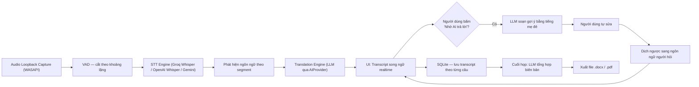
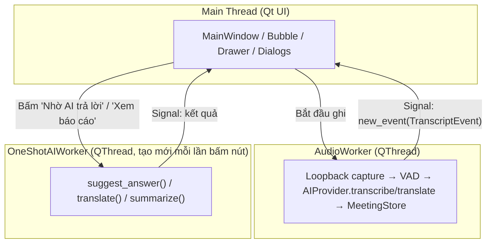
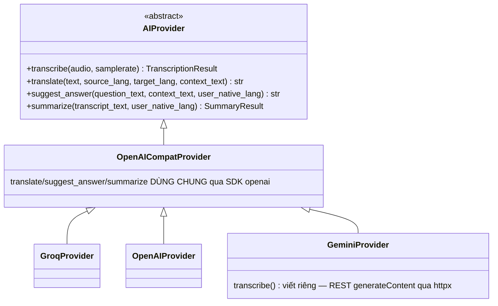
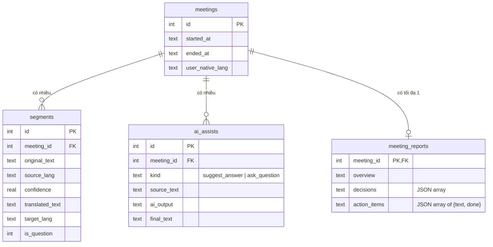

# 🎙️ AI Meeting Companion

**Trợ lý họp đa ngôn ngữ thời gian thực — phụ đề song ngữ, gợi ý trả lời ngược ngôn ngữ, tự động tổng hợp biên bản.**

> ⚠️ **Cảnh báo sử dụng**: Công cụ này hỗ trợ cá nhân ghi chú & chuẩn bị trong cuộc họp. Người dùng cần tự tuân thủ quy định nội bộ công ty và pháp luật về ghi âm tại nơi làm việc. Toàn bộ dữ liệu được lưu **cục bộ trên máy**, không upload mặc định lên bất kỳ server nào ngoài các lệnh gọi API AI mà người dùng tự cấu hình.

---

## 📖 Mục lục

- [Giới thiệu](#-giới-thiệu)
- [Vấn đề & giải pháp](#-vấn-đề--giải-pháp)
- [Tính năng chính](#-tính-năng-chính)
- [Ẩn cửa sổ khỏi screen share](#️-ẩn-cửa-sổ-khỏi-screen-share)
- [Kiến trúc hệ thống](#-kiến-trúc-hệ-thống)
- [Công nghệ sử dụng](#-công-nghệ-sử-dụng)
- [Cấu trúc thư mục](#-cấu-trúc-thư-mục)
- [Cài đặt & chạy](#-cài-đặt--chạy)
- [Cấu hình AI Provider](#-cấu-hình-ai-provider)
- [Kiểm thử](#-kiểm-thử)
- [Đóng gói .exe](#-đóng-gói-exe)
- [Lộ trình phát triển](#-lộ-trình-phát-triển)
- [Giới hạn đã biết](#-giới-hạn-đã-biết)
- [Quy trình phát triển](#-quy-trình-phát-triển)
- [So sánh với giải pháp khác](#-so-sánh-với-giải-pháp-khác)
- [License](#-license)

---

## 🎯 Giới thiệu

**AI Meeting Companion** là ứng dụng desktop Windows chạy nền trong lúc người dùng tham gia họp online (Zoom, Teams, Google Meet — bất kỳ app nào, không phụ thuộc trình duyệt). Ứng dụng:

1. **Thu âm hệ thống** (audio loopback — thu lại chính âm thanh đang phát ra từ máy, khác với thu từ microphone), tự cắt câu theo khoảng lặng (VAD).
2. **Chuyển giọng nói thành văn bản + tự nhận diện ngôn ngữ** theo từng câu, hiển thị **transcript song ngữ** (bản gốc + bản dịch sang ngôn ngữ mẹ đẻ) theo thời gian thực.
3. Cho phép bấm **"Nhờ AI trả lời"** tại bất kỳ câu hỏi nào → AI soạn gợi ý trả lời bằng tiếng mẹ đẻ → người dùng tự sửa lại theo ý mình → dịch ngược sang ngôn ngữ người hỏi để đọc/nói phản hồi.
4. Sau cuộc họp: **tự động tổng hợp biên bản** (tóm tắt, quyết định, việc cần làm), xuất file `.docx`/`.pdf`, lưu lịch sử để xem lại.

**Đối tượng sử dụng**: người đi làm có ngoại ngữ yếu hơn tiếng mẹ đẻ, phải họp thường xuyên với cấp trên/khách hàng nước ngoài nói tiếng Anh/Trung/Nhật/Hàn.

---

## 💡 Vấn đề & giải pháp

| Nỗi đau thực tế                                                                                      | Cách AI Meeting Companion giải quyết                                                                                                      |
| ---------------------------------------------------------------------------------------------------- | ----------------------------------------------------------------------------------------------------------------------------------------- |
| Nghe hiểu được câu hỏi nhưng không kịp nghĩ ra câu trả lời tiếng Anh/Trung mượt                      | Soạn gợi ý bằng tiếng mẹ đẻ trước, người dùng tự duyệt & sửa, rồi mới dịch ngược — **không có chế độ auto-send**, luôn qua tay người dùng |
| Theo tiếng Anh/Trung suốt 1 giờ họp rất mệt, dễ bỏ lỡ ý                                              | Transcript song ngữ hiển thị song song, đọc bản dịch ngay khi cần                                                                         |
| Sau họp quên mất ai quyết định gì, ai nhận việc gì                                                   | Tự tổng hợp biên bản bằng AI ngay khi kết thúc, có thể tick hoàn thành action item ngay trong app                                         |
| Hầu hết công cụ tương tự chỉ tối ưu cho tiếng Anh, không có tính năng "gợi ý trả lời ngược ngôn ngữ" | Thiết kế xoay quanh đúng bài toán code-switching Việt↔Anh/Trung/Nhật/Hàn từ đầu                                                           |
| App miễn phí cho cá nhân, không khoá vào 1 nhà cung cấp AI                                           | Kiến trúc `AIProvider` trừu tượng — chọn Groq, OpenAI hoặc Gemini tuỳ key người dùng có sẵn                                               |

---

## ✨ Tính năng chính

| #   | Chức năng                                                                                                                                                                                    | Trạng thái                                        |
| --- | -------------------------------------------------------------------------------------------------------------------------------------------------------------------------------------------- | ------------------------------------------------- |
| F1  | Thu audio loopback hệ thống, tự phục hồi khi đổi thiết bị phát                                                                                                                               | ✅ Hoàn thiện                                     |
| F2  | STT thời gian thực, tự cắt theo câu/khoảng lặng (VAD)                                                                                                                                        | ✅ Hoàn thiện                                     |
| F3  | Tự nhận diện ngôn ngữ mỗi câu (Anh/Việt/Trung/Nhật/Hàn...)                                                                                                                                   | ✅ Hoàn thiện                                     |
| F4  | Hiển thị transcript song ngữ (bubble gốc + bản dịch) theo thời gian thực                                                                                                                     | ✅ Hoàn thiện                                     |
| F5  | Nút "Nhờ AI trả lời" gắn theo từng câu được nhận diện là câu hỏi                                                                                                                             | ✅ Hoàn thiện                                     |
| F6  | Khung gợi ý trả lời bằng tiếng mẹ đẻ, cho sửa tự do                                                                                                                                          | ✅ Hoàn thiện                                     |
| F7  | Dịch ngược bản đã sửa sang ngôn ngữ người hỏi, hiển thị to dễ đọc                                                                                                                            | ✅ Hoàn thiện                                     |
| F8  | Banner cảnh báo đang ghi âm, hiển thị liên tục                                                                                                                                               | ✅ Hoàn thiện                                     |
| F9  | Lưu transcript đầy đủ theo phiên họp (SQLite local)                                                                                                                                          | ✅ Hoàn thiện                                     |
| F10 | Cuối họp: AI tổng hợp biên bản (tóm tắt/quyết định/việc cần làm)                                                                                                                             | ✅ Hoàn thiện                                     |
| F11 | Xuất biên bản ra `.docx` và `.pdf` (hỗ trợ tiếng Việt có dấu)                                                                                                                                | ✅ Hoàn thiện                                     |
| F13 | Lịch sử các cuộc họp cũ, tìm kiếm theo nội dung transcript                                                                                                                                   | ✅ Hoàn thiện                                     |
| F14 | Chọn provider AI (**Groq / OpenAI / Gemini**) trong Settings, tự nhập API key                                                                                                                | ✅ Hoàn thiện                                     |
| F16 | Nhập trước **bối cảnh cuộc họp** (gõ tay + tải file `.txt`/`.md`) để "Nhờ AI trả lời" gợi ý sát tình huống hơn                                                                               | ✅ Hoàn thiện (Vòng 9)                            |
| F17 | **Ẩn toàn bộ cửa sổ app khỏi screen share/quay màn hình** (bật/tắt bằng ⚙️ Cài đặt hoặc phím tắt `Ctrl+Alt+Shift+F9`) — xem mục [Ẩn cửa sổ khỏi screen share](#️-ẩn-cửa-sổ-khỏi-screen-share) | ✅ Hoàn thiện (cần Windows 10 bản 2004+)          |
| F12 | Phân biệt người nói (diarization)                                                                                                                                                            | ⏳ Chưa làm (Phase 4, cân nhắc theo nhu cầu thật) |
| F15 | Chế độ hoàn toàn offline (STT local bằng `faster-whisper`)                                                                                                                                   | ⏳ Chưa làm (Phase 4, cân nhắc theo nhu cầu thật) |

### Một số chi tiết đáng chú ý

- **Lọc hallucination khi im lặng**: dùng tín hiệu `no_speech_prob` riêng biệt từ Whisper (khác với `confidence`) để loại bỏ transcript rác sinh ra từ đoạn im lặng/nhạc nền, **không** dùng confidence chung để tránh lọc nhầm câu ngắn nhưng có thật.
- **Không bịa thông tin**: khi tổng hợp biên bản hoặc soạn gợi ý trả lời, AI được yêu cầu rõ trả về placeholder (`[số liệu cụ thể]`) hoặc danh sách rỗng nếu không có dữ liệu thật trong transcript, thay vì tự sinh số liệu nghe có vẻ hợp lý.
- **Đa nhà cung cấp AI thật, không chỉ cấu hình giả**: `OpenAICompatProvider` dùng chung logic dịch/gợi ý/tóm tắt cho cả 3 provider qua SDK `openai` (chỉ đổi `base_url`); riêng Gemini không có API kiểu Whisper cho STT nên `GeminiProvider.transcribe()` được viết tách riêng, gọi REST `generateContent` trực tiếp qua `httpx`.
- **Bối cảnh cuộc họp (Vòng 9, F16)**: trước khi bấm "Bắt đầu ghi", có thể mô tả trước ai nói với ai/mục đích gì (phỏng vấn, họp công việc, trò chơi...) — nhập tay hoặc tải file `.txt`/`.md` (dùng được cả 2 cách cùng lúc), lưu lại theo phiên họp, dùng cho "Nhờ AI trả lời" trong suốt phiên. **Phạm vi hiện tại chỉ áp dụng cho `suggest_answer()`** — CHƯA áp dụng cho dịch transcript realtime hay tổng hợp biên bản cuối (xem CONTRACTS.md Mục 18 lý do đánh đổi độ trễ).

---

## 🛡️ Ẩn cửa sổ khỏi screen share

Khi bạn đang chia sẻ màn hình (Google Meet, Zoom, Teams...) hoặc quay màn hình (OBS...), **mọi cửa sổ của app** — cửa sổ chính, "Hỏi AI", khung gợi ý trả lời, ⚙️ Cài đặt, menu chuột phải — có thể được ẩn khỏi hình người xem thấy, trong khi **bạn vẫn nhìn thấy bình thường** trên màn hình của mình. Trên Windows đủ mới (10 bản 2004+ / 11), người xem thấy phần nền phía sau như thể app không tồn tại — **dự kiến không có khối đen** (⚠️ phần này **chưa test trên máy thật**, xem [Giới hạn thật](#giới-hạn-thật-không-nhận-vơ)). Trên Windows cũ hơn, nội dung vẫn bị ẩn nhưng người xem thấy **một khối đen** — xem bên dưới.

### Cách dùng

| Cách                          | Chi tiết                                                                                                        |
| ----------------------------- | --------------------------------------------------------------------------------------------------------------- |
| Checkbox trong ⚙️ **Cài đặt** | Tick là áp dụng **ngay**, không cần bấm Lưu. Lựa chọn được nhớ cho lần mở app sau (file `ui_prefs.json`).       |
| Phím tắt toàn cục             | `Ctrl+Alt+Shift+F9` — bật/tắt ngay cả khi Zoom/Meet/Teams đang giữ focus. Cố ý chọn tổ hợp dài để khó bấm nhầm. |
| `.env` (tuỳ chọn)             | `AI_MEETING_HIDE_FROM_CAPTURE=1` — chỉ dùng làm giá trị khởi đầu nếu bạn chưa từng chọn trong Cài đặt.          |

**Mặc định là TẮT** (bản `.exe` phát cho người khác dùng, cửa sổ "tự biến mất" khi quay màn hình mà chưa được báo trước sẽ gây bất ngờ).

Tiêu đề cửa sổ chính là chỉ báo trạng thái (chỉ bạn thấy):

- `🛡 (ẩn khỏi share)` — đã áp dụng cờ ẩn thành công (trên Windows cũ, nội dung bị ẩn nhưng có thể hiện khối đen — xem bên dưới).
- `⚠ (KHÔNG ẩn được khỏi share)` — đã bật nhưng hệ điều hành từ chối lệnh; cửa sổ vẫn hiện với người xem. Chi tiết trong ⚙️ Cài đặt và `app.log`.
- Không có hậu tố — tính năng đang tắt, cửa sổ hiện bình thường.

### Cơ chế & yêu cầu

App gọi `SetWindowDisplayAffinity(hwnd, WDA_EXCLUDEFROMCAPTURE)` (qua `ctypes`, không thêm dependency) cho **mọi cửa sổ cấp cao nhất** thông qua 1 event filter ở tầng `QApplication`.

> ⚠️ **Ẩn "sạch" (không khối đen) cần Windows 10 bản 2004 (build 19041) trở lên, hoặc Windows 11.** Trên Windows cũ hơn (vd build 17763 = Windows 10 1809), hệ điều hành **âm thầm** xử lý cờ này như `WDA_MONITOR` — API vẫn báo "thành công" nhưng người xem (và cả ảnh chụp màn hình) thấy **một khối đen** đè đúng chỗ cửa sổ. Đây là hành vi của Windows, app **không** xử lý riêng: trên máy cũ app vẫn bật ẩn như bình thường (nội dung bị ẩn, nhưng còn khối đen). Nếu khối đen gây phiền khi share, hãy tắt tính năng, hoặc share **từng cửa sổ/tab** thay vì toàn màn hình, hoặc đặt app ở màn hình phụ.

Kiểm tra bản Windows của bạn: nhấn `Win + R`, gõ `winver`, hoặc chạy:

```powershell
python -c "import sys; print(sys.getwindowsversion().build)"   # >= 19041 thì ẩn sạch
```

### Giới hạn thật (không nhận vơ)

- Chỉ chặn capture ở **tầng hệ điều hành**. **Không** chặn: quay bằng điện thoại/máy ảnh, capture card phần cứng, phần mềm giám sát cấp driver/kernel. Đây không phải cơ chế bảo mật hay DRM.
- Cần **Desktop Window Manager** đang hoạt động (bình thường trên Windows 10/11; có thể không hiệu quả trong một số phiên Remote Desktop/máy ảo).
- **Tắt giữa buổi share = cửa sổ lộ NGAY** với mọi người đang xem. Hãy nhìn tiêu đề `🛡` trước khi chia sẻ.
- **Chưa verify trên Windows >= 19041 + Meet/Zoom/Teams/OBS thật**: hành vi "không khối đen" trên máy mới là kỳ vọng theo tài liệu Microsoft, chưa được test thật. Đã test thật trên Windows build 17763 (Google Meet): nội dung bị ẩn, còn khối đen.
- Nếu máy mới vẫn có khối đen hoặc `⚠`: thử cập nhật driver card đồ hoạ, tắt/bật lại share, và ghi lại số build, GPU, chế độ share (toàn màn hình/cửa sổ/tab) cùng `app.log` để chẩn đoán — một số cấu hình GPU/trình duyệt có thể xử lý cờ này khác chuẩn.
- Phím tắt cố định (chưa cho đổi trong Settings); nếu bị app khác chiếm, app chỉ ghi cảnh báo vào log và checkbox vẫn dùng được.

---

## 🏗️ Kiến trúc hệ thống

### Luồng dữ liệu



### Mô hình luồng xử lý (threading)

Ứng dụng dùng PySide6/Qt — UI thread **không bao giờ** bị block bởi network hoặc I/O:



**Nguyên tắc bất biến** (xem `CONTRACTS.md` trong repo để biết đầy đủ):

- Mỗi `QThread` **tự tạo** kết nối SQLite và `AIProvider` riêng **bên trong** `run()` của chính nó — không nhận instance đã tạo sẵn từ thread khác. SQLite `check_same_thread=True` mặc định khoá connection vào đúng thread đã `connect()`, vi phạm nguyên tắc này sẽ crash khi ghi DB.
- Main thread (UI) **chỉ** nhận dữ liệu qua Qt Signal, không bao giờ tự gọi `AIProvider`/`MeetingStore` trực tiếp.
- Mỗi lệnh AI do người dùng bấm nút kích hoạt (gợi ý trả lời, dịch, tổng hợp biên bản) chạy trên `OneShotAIWorker` **riêng**, không tái dùng thread đang chạy vòng lặp ghi âm.
- Ngoại lệ có ý ghi rõ trong `CONTRACTS.md`: tick checkbox action item ghi SQLite trực tiếp trên main thread (UPDATE rất nhỏ, không phải lệnh AI/network).

### Lớp trừu tượng AI Provider — đổi nhà cung cấp không sửa UI



`provider_factory.create_provider()` là **1 điểm duy nhất** quyết định provider nào được khởi tạo, theo thứ tự ưu tiên: tham số truyền vào → biến môi trường `AI_PROVIDER` → lựa chọn đã lưu trong Settings → mặc định `"groq"`. UI và pipeline không bao giờ import trực tiếp `GroqProvider`/`OpenAIProvider`/`GeminiProvider` — luôn gọi qua interface `AIProvider`.

### Schema cơ sở dữ liệu (SQLite, lưu local)



---

## 🛠️ Công nghệ sử dụng

| Hạng mục                 | Công nghệ                                                                         | Vai trò                                                                                    |
| ------------------------ | --------------------------------------------------------------------------------- | ------------------------------------------------------------------------------------------ |
| Ngôn ngữ                 | Python 3.11+                                                                      | Toàn bộ ứng dụng                                                                           |
| UI Desktop               | PySide6 (Qt)                                                                      | Giao diện dark-mode, QSS custom theme                                                      |
| Audio capture            | `soundcard`, `pyaudiowpatch`                                                      | Thu loopback audio qua WASAPI (Windows)                                                    |
| Voice Activity Detection | `webrtcvad-wheels`                                                                | Cắt audio thành segment theo khoảng lặng                                                   |
| STT (Speech-to-Text)     | Groq Whisper (`whisper-large-v3`) / OpenAI `whisper-1` / Gemini `generateContent` | Chuyển giọng nói thành văn bản + nhận diện ngôn ngữ                                        |
| Dịch / gợi ý / tóm tắt   | Groq Llama 3.3 70B & 3.1 8B / OpenAI GPT / Gemini                                 | Qua SDK `openai` dùng chung (base_url khác nhau) + `httpx` cho REST trực tiếp (Gemini STT) |
| Lưu trữ                  | SQLite (`sqlite3` chuẩn thư viện)                                                 | Transcript, lịch sử AI hỗ trợ, biên bản theo phiên                                         |
| Bảo mật API key          | Windows DPAPI (qua `ctypes`, fallback non-Windows)                                | Mã hoá key lưu local, không hardcode                                                       |
| Xuất báo cáo             | `python-docx`, `reportlab`                                                        | Xuất `.docx`/`.pdf`, tự register font Unicode cho tiếng Việt                               |
| Cấu hình                 | `python-dotenv`                                                                   | Đọc biến môi trường khi chạy từ source                                                     |
| Đóng gói                 | PyInstaller                                                                       | Build `.exe` chạy độc lập trên Windows                                                     |
| Kiểm thử                 | `unittest`/`pytest`-style script tự viết, mock provider                           | Test offline, không cần network/API key thật                                               |

---

## 📂 Cấu trúc thư mục

```
ai-meeting-companion/
├── app/
│   ├── main.py                    # Entry point — chạy `python -m app.main`
│   ├── config_store.py            # Lưu API key + provider đang chọn (DPAPI/local)
│   ├── pipeline.py                # Ghép VAD + AIProvider + DB, độc lập Qt (test được)
│   ├── report.py                  # Build transcript text dùng chung
│   ├── report_export.py           # Xuất .docx/.pdf
│   ├── ai/
│   │   ├── base_provider.py       # Interface AIProvider + TranscriptionResult + SummaryResult
│   │   ├── openai_compat_base.py  # translate/suggest_answer/summarize dùng chung 3 provider
│   │   ├── whisper_utils.py       # Parse response Whisper verbose_json (Groq + OpenAI)
│   │   ├── groq_provider.py       # GroqProvider
│   │   ├── openai_provider.py     # OpenAIProvider
│   │   ├── gemini_provider.py     # GeminiProvider (STT viết riêng qua REST)
│   │   └── provider_factory.py    # create_provider() — 1 điểm chọn provider
│   ├── audio/
│   │   ├── capture.py             # Thu loopback + tự phục hồi khi đổi device
│   │   └── vad.py                 # Cắt segment theo khoảng lặng
│   ├── storage/
│   │   └── db.py                  # MeetingStore — schema + CRUD SQLite
│   └── ui/
│       ├── main_window.py         # Cửa sổ chính + AudioWorker (QThread) + wiring
│       ├── transcript_bubble.py   # Widget hiển thị 1 segment
│       ├── suggestion_drawer.py   # Panel soạn gợi ý trả lời
│       ├── ask_question_dialog.py # "Tôi muốn hỏi" — chiều ngược lại
│       ├── report_view.py         # Dialog xem/tạo lại/xuất biên bản
│       ├── history_dialog.py      # Xem/tìm lại phiên họp cũ
│       ├── settings_dialog.py     # Chọn provider AI + nhập API key + checkbox ẩn khỏi share
│       ├── capture_protection.py  # Ẩn mọi cửa sổ khỏi screen share (WDA_EXCLUDEFROMCAPTURE)
│       ├── global_hotkey.py       # Phím tắt toàn cục Ctrl+Alt+Shift+F9 (RegisterHotKey)
│       ├── ai_worker.py           # OneShotAIWorker — chạy 1 lệnh AI trên thread riêng
│       └── theme.qss              # Dark-mode theme
├── scripts/                       # Script test riêng từng phần qua terminal (debug nhanh)
├── tests/                         # Unit test — chạy offline, mock provider/audio
├── requirements.txt
├── .env.example
└── README.md
```

---

## 🚀 Cài đặt & chạy

### Yêu cầu

- Windows 10/11 (audio loopback WASAPI là tính năng riêng của Windows). Riêng tính năng [ẩn cửa sổ khỏi screen share](#️-ẩn-cửa-sổ-khỏi-screen-share) cần **Windows 10 bản 2004 (build 19041) trở lên**
- Python 3.11+
- API key của **ít nhất 1** trong 3 provider: [Groq](https://console.groq.com) (miễn phí, khuyến nghị bắt đầu), [OpenAI](https://platform.openai.com), hoặc [Gemini](https://ai.google.dev)

### Các bước

```bash
git clone https://github.com/kirito777sao/AIMeetingCompanion.git
cd AIMeetingCompanion

python -m venv .venv
.venv\Scripts\activate          # PowerShell/CMD trên Windows

pip install -r requirements.txt

copy .env.example .env          # rồi mở .env, điền API key của provider bạn có
python -m app.main
```

> ⚠️ Luôn chạy bằng `python -m app.main`, **không** chạy trực tiếp `python app/main.py` — nếu không, Python sẽ không nhận diện đúng `app/` là 1 package, gây lỗi import.

---

## 🔑 Cấu hình AI Provider

Ứng dụng hỗ trợ **3 nhà cung cấp AI**, không khoá cứng vào 1 bên:

| Provider   | STT (giọng nói → văn bản)                                     | Dịch / Gợi ý / Tóm tắt                  | Free tier                  |
| ---------- | ------------------------------------------------------------- | --------------------------------------- | -------------------------- |
| **Groq**   | `whisper-large-v3` (+ fallback `whisper-large-v3-turbo`)      | Llama 3.3 70B (+ fallback Llama 3.1 8B) | Có, không cần thẻ          |
| **OpenAI** | `whisper-1`                                                   | GPT (tuỳ model cấu hình)                | Theo tài khoản OpenAI      |
| **Gemini** | REST `generateContent` riêng (không có endpoint kiểu Whisper) | Gemini qua lớp tương thích OpenAI       | Free tier Google AI Studio |

**Cách đổi provider**: mở app → ⚙️ **Cài đặt** → chọn provider trong dropdown → dán API key tương ứng → Lưu. Mỗi provider lưu key **riêng biệt** — đổi qua lại không mất key đã nhập của provider khác. Khi 1 provider hết quota (lỗi 429), app tự thử lại 1 lần với model phụ trước khi báo lỗi cho người dùng.

Khi dev/test từ source code, có thể ép provider qua biến môi trường trong `.env`:

```
AI_PROVIDER=openai   # hoặc "groq" / "gemini"
```

---

## 🧪 Kiểm thử

Toàn bộ test chạy **offline** (mock provider/audio), không cần Windows, không cần network, không cần API key thật:

```bash
python tests/test_vad.py
python tests/test_groq_provider_offline.py
python tests/test_openai_provider_offline.py
python tests/test_gemini_provider_offline.py
python tests/test_provider_factory_offline.py
python tests/test_db.py
python tests/test_meeting_context_offline.py
python tests/test_pipeline.py
python tests/test_report_export.py
python tests/test_config_store.py
python tests/test_capture.py
python -m pytest tests/test_capture_protection.py -v       # ẩn khỏi screen share (25 test, user32 giả)
QT_QPA_PLATFORM=offscreen python tests/test_ui_smoke.py   # bỏ biến này trên Windows có màn hình thật
```

Phạm vi test bao phủ: logic cắt segment VAD, logic transcribe/translate/suggest_answer/summarize của cả 3 provider (kể cả lựa chọn qua `provider_factory`), schema + CRUD SQLite, ghép nối toàn pipeline (kể cả lọc hallucination qua `no_speech_prob`), nội dung + font khi xuất `.docx`/`.pdf`, lưu/đọc API key local, phát hiện đổi thiết bị phát âm thanh, và toàn bộ wiring UI ↔ thread ↔ DB không bị treo/crash.

**Không thể test được trong môi trường CI/sandbox** (cần xác nhận thủ công trên Windows thật): chất lượng output thật của AI (độ chính xác STT, độ tự nhiên bản dịch), độ trễ network thật, audio loopback thật, mã hoá DPAPI thật, hiển thị đúng dấu tiếng Việt khi xuất PDF với font hệ thống "Segoe UI", và **hành vi thật của tính năng ẩn cửa sổ khỏi screen share** với từng phần mềm họp/quay màn hình (test chỉ dùng `user32` giả để kiểm tra đúng HWND, đúng cờ, đúng nhánh lỗi).

---

## 📦 Đóng gói .exe

```bash
pip install pyinstaller

pyinstaller --noconfirm --windowed --name "AIMeetingCompanion" \
  --add-data "app/ui/theme.qss;app/ui" \
  -m app.main
```

Kết quả nằm tại `dist/AIMeetingCompanion/AIMeetingCompanion.exe`, chạy độc lập trên máy không cài Python — người dùng cuối tự mở ⚙️ Cài đặt để nhập API key của riêng họ, không cần file `.env`.

> ⚠️ Nếu có cài `qt-material` (skin UI tuỳ chọn, Vòng 9 — xem Mục "Tính năng chính"): package này có kèm data file (theme `.xml`, font) mà PyInstaller mặc định KHÔNG tự phát hiện — cần thêm `--collect-data qt_material` vào lệnh `pyinstaller` ở trên, nếu không app đóng gói sẽ fallback về style mặc định dù máy dev có cài package. CHƯA tự verify bước này trên Windows thật.

---

## 🗺️ Lộ trình phát triển

| Giai đoạn          | Nội dung                                                                                      | Trạng thái                                                                                                                                 |
| ------------------ | --------------------------------------------------------------------------------------------- | ------------------------------------------------------------------------------------------------------------------------------------------ |
| Phase 0            | Proof of concept — audio loopback → Groq Whisper → console                                    | ✅                                                                                                                                         |
| Phase 1            | MVP lõi — UI PySide6, transcript song ngữ realtime, consent banner, lưu local (F1-F4, F8, F9) | ✅                                                                                                                                         |
| Phase 2            | Trợ lý trả lời — gợi ý, sửa, dịch ngược (F5-F7)                                               | ✅                                                                                                                                         |
| Phase 3            | Biên bản cuộc họp — tổng hợp, xuất file, lịch sử (F10, F11, F13)                              | ✅                                                                                                                                         |
| _Mở rộng_          | Multi-provider AI — Groq/OpenAI/Gemini, mỗi người tự chọn + tự nhập key (F14)                 | ✅                                                                                                                                         |
| _Mở rộng_          | Bối cảnh cuộc họp cho "Nhờ AI trả lời" + skin UI `qt_material` tuỳ chọn (F16, Vòng 9)         | ✅ (chưa tự verify UI thật trên Windows — xem CONTRACTS.md Mục 18.3)                                                                       |
| Phase 4 (đề xuất)  | Đóng gói `.exe` chuyên nghiệp + retest toàn bộ trên Windows thật                              | Khuyến nghị làm **trước tiên** trong Phase 4 — lộ ra bug đóng gói (DPAPI, đường dẫn, antivirus) không thể lường hết khi chỉ chạy từ source |
| Phase 4 (cân nhắc) | `faster-whisper` chạy local — fallback khi mất mạng/hết quota cả 3 provider (F15)             | Chỉ làm nếu thực sự cần dùng nơi mạng không ổn định — kéo theo PyTorch, ảnh hưởng mục tiêu ".exe nhẹ"                                      |
| Phase 4 (cân nhắc) | Diarization — phân biệt người nói (F12)                                                       | Chỉ làm nếu use-case thật cần biết "ai nói câu nào"                                                                                        |

---

## ⚠️ Giới hạn đã biết

- **Độ chính xác STT** giảm với accent nặng hoặc code-switching nhiều ngôn ngữ trong cùng 1 câu — chấp nhận ở V1, người dùng có thể tự sửa transcript.
- **Độ trễ pipeline** ~1.5–4s mỗi lệnh gọi cloud (giới hạn vốn có của free-tier, không có cách miễn phí xoá hẳn) — UI luôn hiển thị trạng thái xử lý trung thực, không cam kết realtime tuyệt đối.
- **Gemini STT** dùng REST `generateContent` (không có endpoint kiểu Whisper chính thức) — `confidence` hiện là số cố định 0.75 (placeholder), `no_speech_prob` là tín hiệu nhị phân (0.0/1.0), không mịn như Whisper thật.
- **Diarization và chế độ offline hoàn toàn** chưa được triển khai (xem Phase 4).
- **Bối cảnh cuộc họp (F16)** hiện chỉ ảnh hưởng "Nhờ AI trả lời" — dịch transcript song ngữ realtime và tổng hợp biên bản cuối họp CHƯA dùng tới, dù đã thiết kế dự phòng cho việc mở rộng sau này (xem CONTRACTS.md Mục 18).
- **Skin UI `qt_material`** (Vòng 9) là tuỳ chọn, chưa tự verify hiển thị thật trên Windows kết hợp với `theme.qss` có đẹp/dễ nhìn như kỳ vọng không.
- **Ẩn cửa sổ khỏi screen share (F17)** chỉ ẩn "sạch" (không khối đen) trên Windows 10 bản 2004+/11 và chỉ chặn capture ở tầng hệ điều hành — xem chi tiết ở mục [Ẩn cửa sổ khỏi screen share](#️-ẩn-cửa-sổ-khỏi-screen-share).
- Nội dung nhạy cảm (số liệu công ty, thông tin khách hàng) đi qua API cloud của bên thứ ba theo đúng chính sách của từng provider — người dùng cần tự cân nhắc trước khi dùng cho cuộc họp có nội dung mật.

---

## 🤝 Quy trình phát triển

Dự án được phát triển theo quy trình lặp nhỏ, **mỗi thay đổi đều có unit test xác nhận trước khi merge**, không nhận output AI/model mà không kiểm chứng:

- Mọi quyết định kiến trúc khoá cứng (interface `AIProvider`, schema DB, quy ước threading...) được ghi lại trong `CONTRACTS.md` — tài liệu nguồn sự thật duy nhất khi sửa code.
- Phần lõi logic (VAD, provider, pipeline, export, config) được viết với test mock đi kèm ngay trong cùng commit, chạy được hoàn toàn offline.
- Hành vi phụ thuộc phần cứng/Windows thật (audio loopback, DPAPI, font hệ thống) luôn được verify thủ công trên máy Windows thật trước khi coi là "xong" — không chỉ dựa vào test mock.
- Một phần codebase được phát triển với sự hỗ trợ của AI pair-programming (Claude), theo đúng quy trình kiểm thử trên — mọi thay đổi đều được verify bằng test thật, không nhận code không qua kiểm chứng.

---

## 🆚 So sánh với giải pháp khác

| Sản phẩm                      | Điểm mạnh                                     | Hạn chế so với AI Meeting Companion                        |
| ----------------------------- | --------------------------------------------- | ---------------------------------------------------------- |
| Otter.ai, Fireflies.ai, tl;dv | Tổng hợp biên bản tốt, tích hợp nhiều app họp | Tập trung tiếng Anh, không có gợi ý trả lời ngược ngôn ngữ |
| Microsoft Teams + Copilot     | Tích hợp sẵn, transcript + summary            | Chỉ hoạt động trong Teams, trả phí                         |
| Wordly.ai, Interprefy         | Phiên dịch hội nghị chuyên nghiệp             | Sản phẩm doanh nghiệp, giá rất cao                         |
| Krisp.ai                      | Khử ồn + transcript tốt                       | Không dịch song ngữ, không có trợ lý trả lời               |

**Điểm khác biệt**: kết hợp transcript song ngữ + trợ lý soạn & dịch ngược câu trả lời, đúng trọng tâm bài toán "yếu ngoại ngữ trong họp với cấp trên/khách hàng nước ngoài" — miễn phí cho cá nhân, không khoá vào 1 nhà cung cấp AI.

---

## 📄 License

MIT License — xem chi tiết tại [LICENSE](LICENSE).

---

<p align="center">Made with Python, PySide6 và rất nhiều lần retest trên Windows thật 🇻🇳</p>
